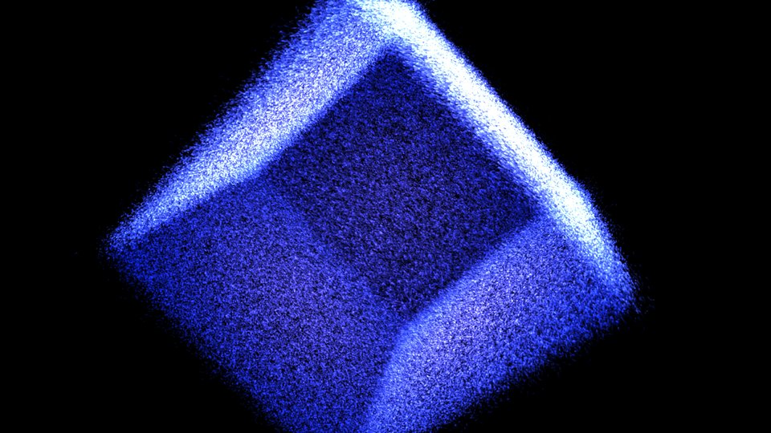
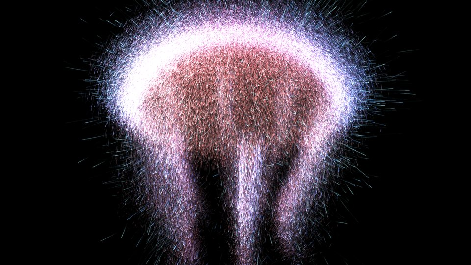
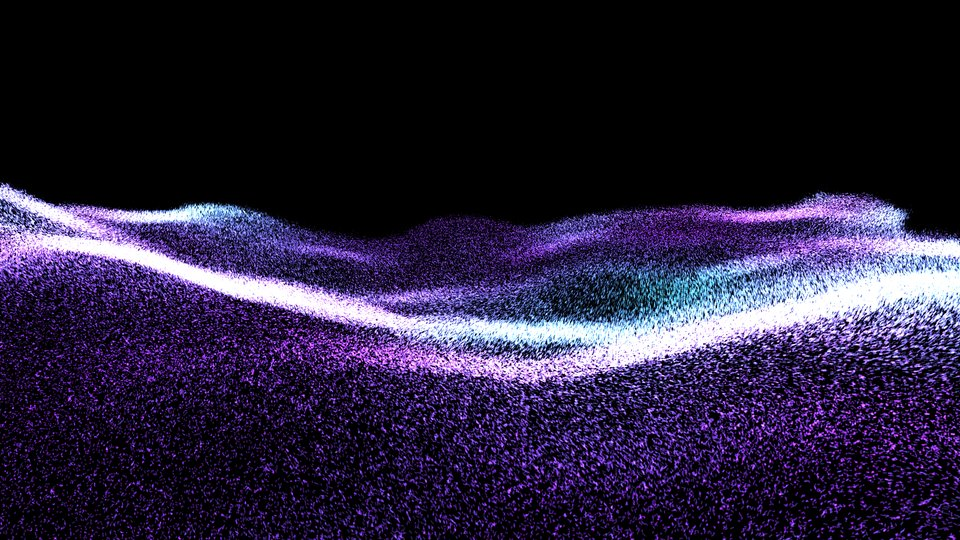
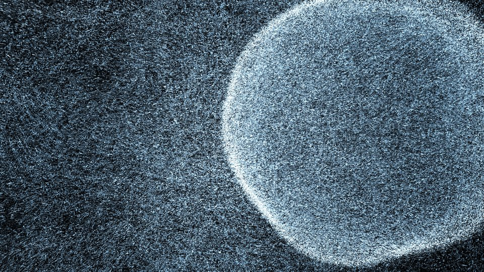

# SwarmMorph

**A particle swarm for Resolume that morphs between your 3D models.**

Load two 3D models (`.obj` or Alembic `.abc`), and SwarmMorph turns them into a cloud of up
to one million glowing particles. Move the **Morph** fader and the whole swarm
takes off, swirls through the air and lands on the other shape. Animated meshes
from Blender work too: the particles ride along with the moving surface.

SwarmMorph is a native FFGL source plugin for **Resolume Arena and Avenue** on
**macOS and Windows**. Everything runs on the GPU, so it stays smooth at full
HD and beyond.

| | |
|---|---|
|  |  |
|  |  |

- Morph between two models, or split the swarm across both; 14 built-in shapes, five of them animated
- 10,000 to 1,048,576 particles
- Animated meshes from Blender, Cinema 4D, Houdini or Maya as Alembic (`.abc`) or OBJ sequences
- Wind, gusts, vortex and explode forces that bend the shape and let it spring back
- Blow particles off the shape and across the screen, wrapping around the edges
- Swirl, buzz and a free-spinning camera
- Beat effects locked to Resolume's BPM: pulse, shockwave, burst, jitter, flash, and spin steps
- Two-colour gradients by speed, height or depth, random sparks, twinkle and depth fog
- Key, rim and centre lights in their own colours, streaks and built-in trails
- Ready-made presets that install themselves
- Meshes load in the background, so loading a new file mid-show doesn't drop frames

## Download and install

1. Download the zip for your system from the
   [Releases page](https://github.com/yastefan/SwarmMorph-ffgl/releases).
   Pick the newest versioned release, or **Latest build from main** for the
   very latest changes.
2. Quit Resolume.
3. Copy the plugin from the zip into Resolume's **Extra Effects** folder:

   | System  | File from the zip   | Folder |
   |---------|---------------------|--------|
   | Windows | `SwarmMorph.dll`    | `Documents\Resolume Arena\Extra Effects` |
   | macOS   | `SwarmMorph.bundle` | `Documents/Resolume Arena/Extra Effects` |

   For Avenue, use `Resolume Avenue` instead of `Resolume Arena` in the path.
4. **macOS only:** macOS blocks plugins downloaded from the internet. Open
   Terminal in that folder and run:

   ```bash
   xattr -dr com.apple.quarantine SwarmMorph.bundle
   ```

5. Start Resolume. SwarmMorph appears in the **Sources** tab.

### Presets

SwarmMorph comes with presets: BPM Box, BPM Time Bomb, Borg Cube, Cyber
Ocean, Grunge Donut, Jealous Jellyfish, Mystic Ball, Sea Gras and Stormy
Crysis. The
first time you use the plugin, it copies them into
`Documents/Resolume Arena/Presets/Sources/SwarmMorph` (and the Avenue folder,
if you have one); restart Resolume once if the preset menu doesn't show them
yet. Presets you already have there are never overwritten, and a preset you
delete stays deleted. The zip also holds them in `Presets`, to copy by hand.

Requirements: Resolume Arena or Avenue 7 (developed with Arena 7.28) and a
graphics card with OpenGL 4.1, which every Mac and Windows GPU of the last
decade has. Macs with Intel or Apple Silicon are both supported.

## Your first swarm

1. Drag **SwarmMorph** from the Sources tab onto an empty clip and trigger it.
   You'll see a sphere of particles.
2. Push **Morph** (in the **Meshes** group) to 100 %, and watch the swarm
   fly from the sphere to a torus. Pick other built-in forms under **Shape**
   in the **Mesh 1** and **Mesh 2** groups; the last five (Heartbeat,
   Superform, Jellyfish, Bloom, Ocean) move by themselves.
3. For your own models, choose an `.obj` or `.abc` file under **Mesh 1** or
   **Mesh 2**; it replaces that group's shape. Clear the file to get the
   shape back.
4. Now play: raise **Turbulence** for wilder flights, lower **Attraction** for
   slow, dreamy transitions, push **Wind X** for a gust, raise **Burst** and
   hit **Hit** for an explosion.

No models at hand? The [`examples/meshes`](examples/meshes) folder of this
repository has a torus, a knot, a cube and a wave to start with.
For animation, [`tools/blender/make_creature_animations.py`](tools/blender/make_creature_animations.py)
builds ten seamlessly looping Alembic creatures in Blender: a pulsing
jellyfish, manta ray, koi, sea serpent, butterfly, blooming lotus, sea
anemone, kelp forest, DNA helix and octopus (see *Testing without Resolume*
for the command).

## Ideas for live shows

- **Morph on a fader:** map **Morph** to a MIDI fader or your crossfader.
  The swarm follows the fader with all its swirl and buzz; stop halfway for
  a cloud that's neither one nor the other. For a morph on the beat, give
  Morph a BPM-synced animation in Resolume.
- **Off-centre:** **Anchor X/Y/Z** picks the point of each mesh that sits at
  the centre. Shift Mesh 2's anchor and the swarm travels across the
  picture while it morphs; with **Spin**, the shape orbits round the anchor
  instead of turning on the spot. **Scale** sizes each mesh around its
  anchor, so a small sphere can morph into a huge cube that fills the screen.
- **Two at once:** with **Split** at 100 % and Morph at 50 %, both meshes
  stand in the picture, each with half the particles. Give them different
  anchors to put them side by side; moving Morph then lets the swarm
  trickle over from one shape to the other.
- **Living shapes:** the animated shapes run on their own. The swarm
  smooths quick motion, so **Heartbeat** breathes softly at the default
  **Attraction**; raise Attraction to near 100 % for a sharp double beat.
- **On the beat:** the **Beat** effects follow Resolume's BPM by themselves.
  Leave **Beat Rate** on 1 Beat, raise **Pulse** or **Shockwave** a little,
  and the shape breathes with the music. Set Beat Rate to Off and map **Hit**
  to a pad or an audio trigger to play them by hand.
- **Hit the kick:** set **Beat Rate** to Off, **Burst** to 100 % and map
  **Hit** to a pad or an audio-reactive trigger for an explosion that
  settles back into the shape.
- **Fireflies:** turn **Surface Flow** down, **Buzz** and **Twinkle** up and
  lower **Particles** with a bigger **Point Size**: every particle visibly
  buzzes and blinks around the model on its own.
- **Breathing shapes:** slowly raise **Surface Flow** and **Hover** during a
  breakdown and the model dissolves into a living, crawling swarm; pull them
  back down for the drop.
- **Hot flight:** set **Color Mode** to Speed, **Color 2** to orange and
  **Color Mix** to about 0.6: the swarm burns while it morphs and cools back
  to Color 1 as it settles.
- **Sparks:** Color Mode Random, **Color Mix** around 0.1 and some
  **Twinkle** sprinkle a few golden sparks into a blue swarm.
- **Camera moves:** pick a **Path** and put **Path Position** on the
  timeline (or a BPM-synced saw) for a continuous move that loops cleanly.
  **Fly Through** dives into the swarm and turns round inside it;
  **Vertigo** is a dolly zoom. Spin, Rotate and Zoom still work on top.
- **Light trails:** raise **Trails** (in **Look**) and **Streaks** to about
  0.5: blown-away and bursting particles draw smooth, fading curves instead
  of dotted lines. Resolume's own Trails effect on the clip works too.
  If long trails make the swarm look too hectic, lower **Speed**.
- **Tunnel:** **Trails** up and **Trail Zoom** to the right: the tails stream
  outwards from the centre, like flying through the swarm. To the left they
  are sucked inwards.
- **Sculpted light:** lower **Self Glow** to about 10 %, then raise
  **Key Light** and some **Rim**: the shape gets a lit and a dark side. Give
  them different colours, say a warm **Key Color** and a cool **Rim Color**,
  for a film look. Key light and rim only reach particles near the surface;
  free-flying ones keep their Self Glow.
- **Lantern:** **Self Glow** near 0 and **Center Light** up: the shape glows
  from inside, and particles blown out of it fade into the dark.
- **Fly-in on clip change:** turn on **Spawn On Start** and pick a
  **Spawn From**. Every time you switch to the clip, the swarm scatters and
  swarms into the shape; with **Attraction** low it takes its time.
- **Fader weather:** put **Wind X/Y/Z**, **Vortex** and **Explode** on faders.
  All of them rest at the centre, so the shape stays calm until you move them.
- **Blown away:** set some **Wind X**, then raise **Blow Away**. Particles
  peel off the model and drift across the screen; with **Wrap Edges** on they
  come back in on the other side, so at 100 % the model turns into an endless
  stream. Pull the fader down and they fly home and rebuild the shape.
- **Logos and lettering:** export a logo or 3D text from Blender as `.obj`
  and let the swarm assemble it.
- **Layer it:** SwarmMorph's background is transparent and the particles are
  drawn additively, so it sits nicely on top of other clips.

## Getting models

Any `.obj` or Alembic `.abc` file works: exports from Blender, Cinema 4D,
Houdini, Maya, or models downloaded from the web. The polygon count hardly matters, since the
particles are spread evenly across the surface rather than placed on the
vertices. Every model is centred and scaled to the same size; turn
**Normalize** off to keep the original size and position.

From Blender: **File → Export → Wavefront (.obj)** for a still model, or
**File → Export → Alembic (.abc)** for anything that moves (see below).
Materials and textures are ignored; only the shape counts.

## Parameters

The parameters appear in Resolume in this order:

| Group     | Parameter         | What it does |
|-----------|-------------------|--------------|
| Meshes    | Morph             | Slide the swarm from Mesh 1 (0) to Mesh 2 (1), like a crossfader |
|           | Split             | 0: every particle glides together, so halfway the swarm is a cloud between the meshes. 1: each particle switches over at its own point of the fader, so halfway half the swarm sits on each mesh |
|           | Normalize         | Centre each mesh and scale it to the unit sphere |
|           | OBJ Sequences     | Detect numbered sequences; turn off to load such files as single meshes |
| Mesh 1    | Shape 1           | Built-in form: Sphere, Cube, Torus, Knot, Cylinder, Cone, Helix, Wave or Plane, or an animated one: Heartbeat, Superform (sphere → cube → octahedron → star), Jellyfish, Bloom or Ocean (a 6-second loop that follows Anim Speed and Ping Pong) |
|           | Mesh 1            | `.obj` or `.abc` file; replaces the shape while it is set |
|           | Scale 1           | Size of the mesh around its anchor, ¼× to 4× (centre = 1×) |
|           | Anchor 1 X/Y/Z    | The point of the mesh that sits at the centre, where Spin, Rotate and the camera turn around; ±2 units, centre = the mesh's own centre. Raising X moves the mesh left |
| Mesh 2    | Shape 2           | Built-in form that Morph blends towards (Torus at first) |
|           | Mesh 2            | `.obj` or `.abc` file; replaces the shape while it is set |
|           | Scale 2           | The same for Mesh 2 |
|           | Anchor 2 X/Y/Z    | The same for Mesh 2 |
| Morph     | Speed             | Time scale of the particles: 1× in the middle, 0 freezes them, 2× doubles the pace. Beat, animation and camera keep real time |
| Morph     | Attraction        | Spring strength: how fast particles reach the new shape, and how firmly they hold it |
|           | Damping           | Low values overshoot and wobble, high values glide in |
|           | Chaos             | Per-particle variation of the attraction, so the swarm arrives in waves |
|           | Turbulence        | Swirl while travelling; fades out as particles arrive |
|           | Spawn From        | Where Spawn throws the particles: **Scatter** (all over the picture), **Center** (a burst out of the middle) or **Far** (a wide cloud far behind the shape) |
|           | Spawn On Start    | Spawn every time the clip starts playing, so switching to the clip lets the swarm fly in |
|           | Spawn             | Spawn now (map it to a pad) |
| Swarm     | Surface Flow      | Broad eddies swirl the particles along the surface of the shape, like a swarm crawling over it; the shape keeps its form |
|           | Hover             | Thickness of the loose particle layer floating above and below the surface |
|           | Flow Scale        | Size of the swirls of Turbulence and Hover; Surface Flow's eddies are about three times larger |
|           | Flow Speed        | How fast the swirls and streams change (0 freezes the pattern) |
|           | Buzz              | Every particle wanders around its own spot on the surface, independently of its neighbours |
|           | Buzz Speed        | From slow drifting to nervous flickering |
| Forces    | Wind X/Y/Z        | Wind across the screen (X = right, Y = up, Z = towards you), centre = none. Wind Y below centre acts as gravity. |
|           | Gusts             | Patches of stronger and weaker wind drifting through the shape |
|           | Blow Away         | Share of particles that let go of the shape and ride the wind |
|           | Wrap Edges        | Blown-away particles that leave the picture come back on the other side |
|           | Vortex            | Twist around the vertical axis, either direction |
|           | Explode           | Push outward from the centre; below centre pulls inward |
| Beat      | Beat Rate         | Fire the beat effects on Resolume's tempo: every ½ beat, 1 or 2 beats, 1 or 2 bars, or Off |
|           | Hit               | Fire them by hand (MIDI pad, audio trigger) |
|           | Decay             | How long each hit lasts, from a snap to a soft fade |
|           | Pulse             | The shape swells along its surface |
|           | Shockwave         | A ring runs out from the centre through the shape |
|           | Burst             | A share of the particles (up to all of them, different ones each time) flies off and returns |
|           | Jitter            | Every particle twitches to its own side |
|           | Flash             | Brightness spike |
|           | Spin Step         | The camera turns a step (up to 90°) and springs into place |
| Animation | Anim Speed        | Playback speed of animations, 0–3× (1× = the file's own frame rate; 24 fps for OBJ sequences) |
|           | Ping Pong         | Play forwards and backwards instead of looping |
|           | Restart On Switch | Start the sequence from its first frame when it comes into play (Mesh 1 on load, Mesh 2 when Morph leaves 0) |
| Look      | Particles         | Particle count, 10k – 1M |
|           | Point Size        | In pixels at 1080p and the default distance; points grow more slowly than the shape when the camera comes close, so close-ups stay fine-grained |
|           | Softness          | From crisp dots to soft glowing blobs; the total light stays the same |
|           | Streaks           | Draw each particle as a streak back to where it was a frame ago (0.5 = exactly that far, 1 = twice). Fast particles, and a shape turning with Spin or a camera path, then leave continuous lines under Resolume's Trails instead of dotted ones. Costs more GPU time than round points. |
|           | Trails            | Feedback: particles leave tails that fade out within 0.1–4 s (off at 0). The brighter of tail and particle wins, so a shape that holds still doesn't burn out. Clears when the clip starts |
|           | Trail Zoom        | The tails grow outwards (right) or shrink inwards (left) each frame, for a tunnel; centre = still |
|           | Brightness        | Additive intensity |
|           | Color             | Base colour (a colour picker; its alpha sets how strongly it shines) |
|           | Color 2           | Second colour, used by Color Mode |
|           | Color Mode        | How the two colours are spread: **Speed** (fast particles turn Color 2), **Height** (top to bottom), **Depth** (front to back) or **Random** (each particle one or the other) |
|           | Color Mix         | How much Color 2: 0 = none, 0.5 = the full gradient, 1 = all. For Speed it is the sensitivity, for Random the share of particles. |
|           | Speed Glow        | Moving particles light up and burn towards white, e.g. while they morph |
|           | Twinkle           | Each particle flares up now and then at its own rhythm |
|           | Depth Fade        | The back of the shape fades into darkness, like fog |
| Light     | Self Glow         | The particles' own light in their colour (and their Speed Glow). 100 % = as before; lower it to let the lights below shape the swarm |
|           | Key Light         | Light from one direction: the side facing it lights up, the far side stays at Self Glow |
|           | Key Color         | Colour picker for the key light; lit parts take on this colour (white = a paler shade of the particle colour) |
|           | Light Angle       | Where the key light comes from, relative to the screen: 0° = from the camera, ±90° = from the side, ±180° = from behind |
|           | Light Height      | Key light from above (+) or below (−) |
|           | Rim               | Glow along the outline, where the surface turns away from the camera |
|           | Rim Color         | Colour of the rim |
|           | Center Light      | A lamp inside the shape, as if in fog: particles near the centre light up, whichever way they face |
|           | Center Color      | Colour of the centre light |
| Camera    | Spin              | Continuous rotation, centre = still (the default) |
|           | Rotate X/Y, Zoom  | Camera orientation and distance |
|           | Path              | Camera move: Off, Orbit, Wave Orbit, Spiral, Fly Through, Close Pass, Crane or Vertigo |
|           | Path Position     | Where on the path the camera is (0–100 %); 0 and 100 % are the same shot, so loops are seamless |
|           | Path Speed        | Let the camera travel by itself, up to one loop every 5 s (adds to Path Position) |

**Morph** shapes the flight from one model to the next; **Swarm** is how the
particles move once they have arrived.

**Surface Flow**, **Hover** and **Turbulence** all come from one
evolving curl-noise flow field: it never repeats and never clumps particles
together, but neighbouring particles move together, so the shape itself seems
to flow. **Buzz** is the opposite: each particle follows its own path, like a
swarm of fireflies, while the shape stays crisp. Mix both for streams full of
individual movement. **Surface Flow** and **Hover** use the
surface direction of the model, so they work on meshes with faces; point
clouds get the plain 3D swirl. On very thin parts (wires, tubes) keep
**Surface Flow** low or raise **Flow Scale**, otherwise the streams blur the
detail.

Wind leans the shape downstream and **Gusts** make it flutter, while the
model stays recognisable; higher **Attraction** holds it more firmly. Wind
always blows relative to the screen, even while the camera spins. To really
blow particles away, raise **Blow Away**: they leave the shape one by one, get
carried by the wind and the flow field, and return when you lower it again.
**Vortex** and **Explode** push in the model's own space and twist or inflate
it until you release them.

## Animated meshes

Alembic is the easiest way to bring animation in: one file holds the whole
animation, every object in the scene and its frame rate.

### Alembic (.abc)

In Blender: **File → Export → Alembic (.abc)**, set the frame range, export.
Cinema 4D, Houdini and Maya export Alembic the same way. SwarmMorph reads:

- all polygon and subdivision meshes in the file, merged into one shape
- their object animation (moving, rotating, scaling, parenting) and their
  deformation (armatures, cloth, shape keys, modifiers, all baked into the file)
- the frame rate, so the animation plays at its original speed
- point clouds, when the file contains points but no meshes

A file with a single frame loads as a still model. Only the modern Ogawa
format is supported (the default everywhere since 2013); very old HDF5-based
files are rejected with a message in Resolume's log. Animations are loaded
into memory completely, up to about 1 GB of vertex data.

### OBJ sequences

Pick any file of a numbered sequence (`walk_0001.obj`, `walk_0002.obj`, ...)
for Mesh 1 or 2 and SwarmMorph loads the whole sequence. A sequence needs at
least three digits before `.obj` and two files with the same prefix in the
same folder. In Blender: **File → Export → Wavefront (.obj)**, enable
**Animation** and set the frame range. OBJ files carry no frame rate, so
playback assumes 24 fps; use **Anim Speed** if your scene runs at a
different rate.

### What works

Each particle is tied to a fixed spot on the first frame's surface and
follows that spot through the animation. This needs the same vertex count in
every frame: character, cloth and deformer animations work; simulations that
rebuild their mesh every frame (fluids, remeshing) don't, and frames with a
different vertex count are skipped with a warning in Resolume's log. The
whole animation is normalized as one, so it doesn't jitter in size. Loops
blend the last frame into the first, so export a cycle without repeating
the first frame at the end.

## Troubleshooting

- **SwarmMorph doesn't show up in Sources:** check that the file sits directly
  in the Extra Effects folder and restart Resolume. On macOS, run the `xattr`
  command from the install steps.
- **A model doesn't load, or nothing shows:** Resolume's log names the file
  and the reason; look for lines starting with `SwarmMorph`. On macOS the log
  is `~/Library/Logs/Resolume Arena/Resolume Arena log.txt`.
- **It stutters:** lower **Particles**. Integrated laptop GPUs handle a few
  hundred thousand particles; a dedicated graphics card handles the full million.

## For developers

### Building

Clone with the FFGL SDK submodule:

```bash
git clone --recursive git@github.com:yastefan/SwarmMorph-ffgl.git
```

The first build downloads and compiles [Alembic](https://github.com/alembic/alembic)
and [Imath](https://github.com/AcademySoftwareFoundation/Imath), which takes a
few minutes. Pass `-DSWARMMORPH_WITH_ALEMBIC=OFF` to build without Alembic.

**macOS** (Xcode command line tools, CMake 3.29+):

```bash
cmake -S . -B build -DCMAKE_BUILD_TYPE=Release
cmake --build build
```

**Windows** (Visual Studio 2022 with C++, CMake 3.29+):

```bash
cmake -S . -B build -A x64
cmake --build build --config Release
```

### Development and releases

GitHub Actions builds a universal macOS bundle and an x64 Windows DLL:

1. Work on a branch and open a pull request against `main`. The workflow
   builds both platforms on the pull request; merge once it is green.
2. Every push to `main` replaces the pre-release **Latest build from main**
   (tag `latest-build`) with fresh zips.
3. For a versioned release, bump `project(SwarmMorph VERSION x.y.z)` in
   `CMakeLists.txt` on `main`, then tag that commit:

   ```bash
   git tag v0.2.0
   git push origin v0.2.0
   ```

   The workflow refuses tags that don't match the project version, and
   publishes the release with notes generated from the merged pull requests.
   The plugin reports the major and minor version to Resolume.

**Presets:** save a preset in Resolume, then copy its `.xml` from
`Documents/Resolume Arena/Presets/Sources/SwarmMorph` into `presets/`. The
build embeds every file there, and the plugin installs new ones on first use.
Presets store each parameter by its name, so renaming a parameter loses its
value in existing presets; keep names stable once presets use them.

### Testing without Resolume (macOS)

`swarmmorph-harness` loads the built plugin through `plugMain` like a host,
renders offscreen on an OpenGL 4.1 core context and writes PNG frames:

```bash
python3 tools/make_test_meshes.py
python3 tools/make_test_sequences.py   # animated test patterns, ~100 MB, not checked in
blender --background --factory-startup --python tools/blender/make_alembic_tests.py  # Alembic test files
blender --background --factory-startup --python tools/blender/make_creature_animations.py  # looping Alembic creatures
cmake -S . -B build-debug -DCMAKE_BUILD_TYPE=Debug
cmake --build build-debug
./build-debug/swarmmorph-harness --plugin build-debug/SwarmMorph.bundle --out renders \
    --mesh 1 examples/meshes/torus.obj --mesh 2 examples/meshes/knot.obj \
    --frames 360 --every 30 --at 180 Morph=1
```

In Debug builds the FFGL SDK asserts whenever the plugin leaves the GL context
in a non-default state, which is the most common reason plugins misbehave in
Resolume. Run `--help` for all options, `--list` for the parameter names, and
`--throughput` for performance measurements.

### How it works

- `src/MeshSampler.cpp` parses OBJ files and binds one million random,
  area-weighted surface spots per mesh (a triangle's three vertices plus
  barycentric weights). Since they are independent samples, any prefix is
  uniform too, which is how the particle count changes without resampling.
- Static meshes evaluate the binding once on the CPU. Animated meshes upload
  only the current frame's vertices (blended between neighbouring frames)
  and a skin pass evaluates every particle's binding on the GPU.
- Particle state lives in two RGBA32F textures (position + seed, velocity),
  ping-ponged each frame. The update is a fragment pass: a damped spring
  towards the particle's target point plus a curl-noise flow field (gradient
  noise with analytic derivatives), projected onto the surface near the
  target using the bound triangle's normal. Buzz gives every particle its own
  lane through the noise, keyed by its random seed instead of its position.
  Wind moves the spring's rest point rather than pushing the particle, so the
  in-flight turbulence doesn't kick in. Blown-away particles swap the spring
  for drag towards the air speed and wrap around the camera's view volume.
- Rendering draws one point per particle, fetching its position from the
  state texture.

Two findings from profiling on macOS (Intel Iris Plus): transform feedback was
about 15× slower than the fragment pass, and attribute-less point drawing
(`gl_VertexID` only) about 4× slower than drawing from a static index buffer.
The current design avoids both: 270k particles take about 2 ms per frame and
1M about 7 ms on that GPU.

## License

SwarmMorph is free software under the
[GNU General Public License v3.0 or later](LICENSE).

It builds on the [FFGL SDK](https://github.com/resolume/ffgl) (BSD 3-Clause),
[Alembic](https://github.com/alembic/alembic) (BSD 3-Clause) and
[Imath](https://github.com/AcademySoftwareFoundation/Imath) (BSD 3-Clause),
and on Windows links [GLEW](https://glew.sourceforge.net/) (BSD/MIT).
Their license texts ship in the `licenses` folder of every release zip.
